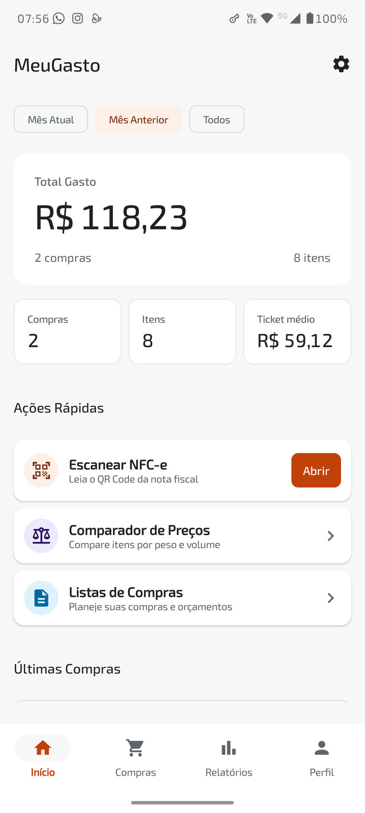
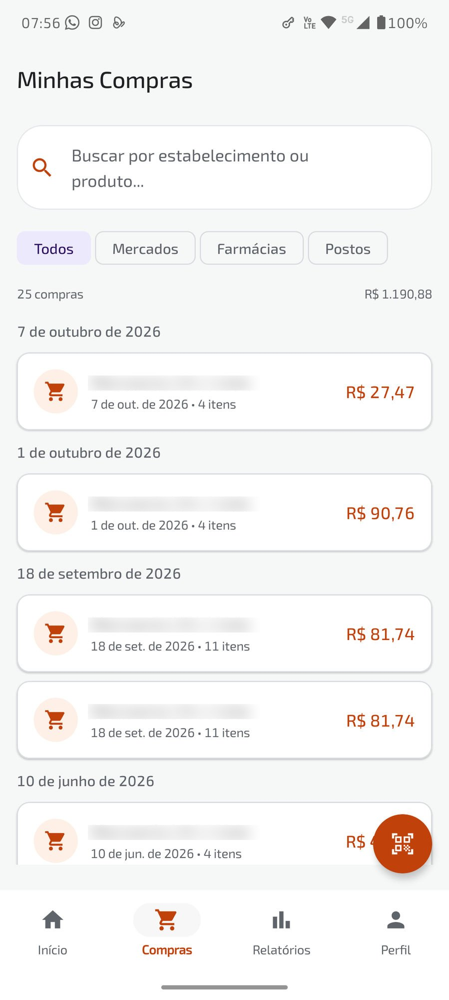
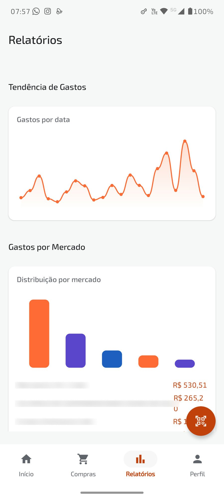
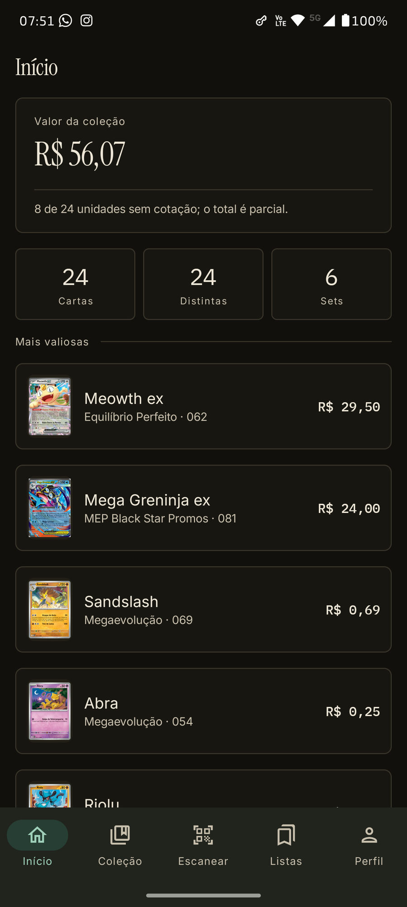
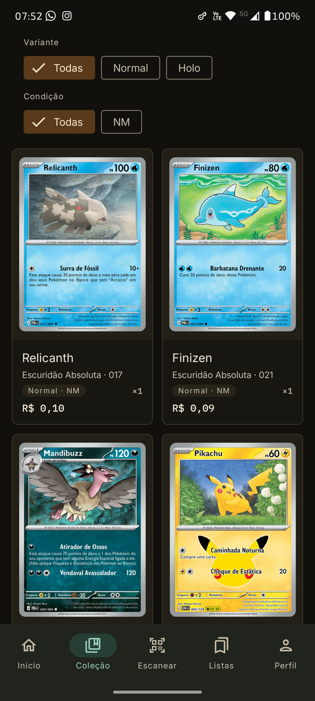

  

<h1 align="center">Leonam Duarte · bashln</h1>

  Desenvolvedor júnior full stack e frontend em Caxias do Sul, RS. 
  Aberto a vagas remotas ou híbridas.

  
  
  
  

## O que eu construo

Apps Android que funcionam sem conta e sem servidor, ferramentas de terminal em Go e interfaces web sem build. Em todos, menos peça móvel e mais comportamento verificável.

## Em destaque

### [MeuGasto](https://github.com/bashln/MeuGasto)

  
  
  

Registra compras de supermercado pelo QR Code da NFC-e. O usuário escaneia o cupom, o app consulta a SEFAZ do estado e grava estabelecimento, data, itens e preços no banco local, sem digitar item por item. A nuvem é opcional e as tabelas de analytics não guardam identidade, com pelo menos cinco contribuintes por agregado.

Kotlin, Jetpack Compose, Room, Ktor e Supabase. [Código](https://github.com/bashln/MeuGasto) e [APK](https://github.com/bashln/MeuGasto/releases).

### [TCG Coleção](https://github.com/bashln/tcg-colecao)

  
  

Organiza coleções de cartas Pokémon no Android e no navegador. O reconhecimento da carta roda no aparelho, a coleção funciona offline e a sincronização entre as duas versões é opcional. O domínio é um módulo Kotlin puro, testado na JVM, separado do módulo Android.

Kotlin, Compose, Room, ML Kit, React 19, TypeScript e Supabase.

### [EcoRota](https://github.com/bashln/ecorota)

Analisa cada viagem com GPS e acelerômetro, dá uma nota de 0 a 100, explica quais comportamentos custaram pontos e estima a economia de combustível. Sem conta, sem analytics e sem servidor.

Kotlin, Jetpack Compose, Room e OpenStreetMap.

## Outros

- OS-ATE, sistema de ordens de serviço que construí no trabalho. Repositório privado, com a lógica e a suíte de testes preservadas e os dados substituídos por placeholders. Go, Vue 3 e SQLite.
- [pomotui](https://github.com/bashln/pomotui), timer Pomodoro em Go para o terminal, com Bubble Tea. Presets, tempos customizados e contadores por fase.
- [portfolio](https://github.com/bashln/portfolio), meu currículo navegável. Uma página estática, bilíngue, sem build e sem dependências de runtime.
- [scripts](https://github.com/bashln/scripts), automação idempotente de pós-instalação para Arch, Fedora e Ubuntu. Também mantenho temas para Neovim, como o [nvim-outrun](https://github.com/bashln/nvim-outrun).

## Contato

Histórico profissional e formação estão no [portfólio](https://bashln.github.io/portfolio/) e no [LinkedIn](https://www.linkedin.com/in/leonam-monteiro-679200362). Para falar comigo, use o [e-mail](mailto:lpdmonteiro@gmail.com).

English

### Leonam Duarte · bashln

Junior full stack and frontend developer in Caxias do Sul, Brazil. Open to remote or hybrid roles.

I build Android apps that need no account or server, Go terminal tools, and web interfaces without a build step. The projects above are public and most run automated checks in CI. MeuGasto and TCG Coleção ship signed APKs from releases.

Professional history and education are on my [portfolio](https://bashln.github.io/portfolio/?lang=en) and [LinkedIn](https://www.linkedin.com/in/leonam-monteiro-679200362). You can reach me by [email](mailto:lpdmonteiro@gmail.com).

